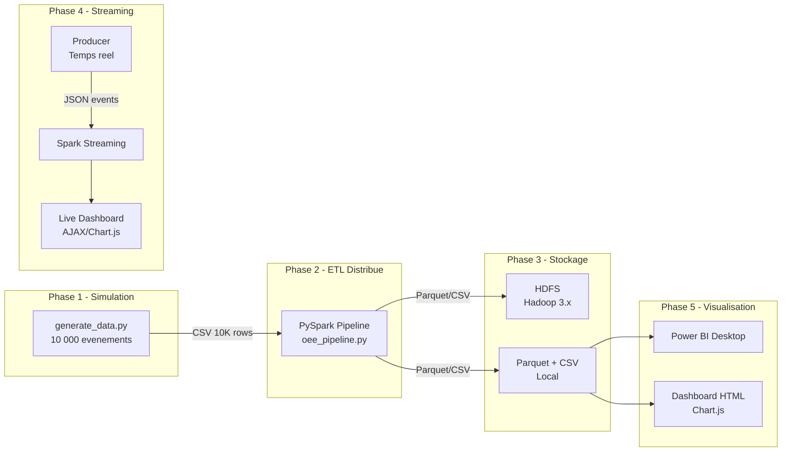
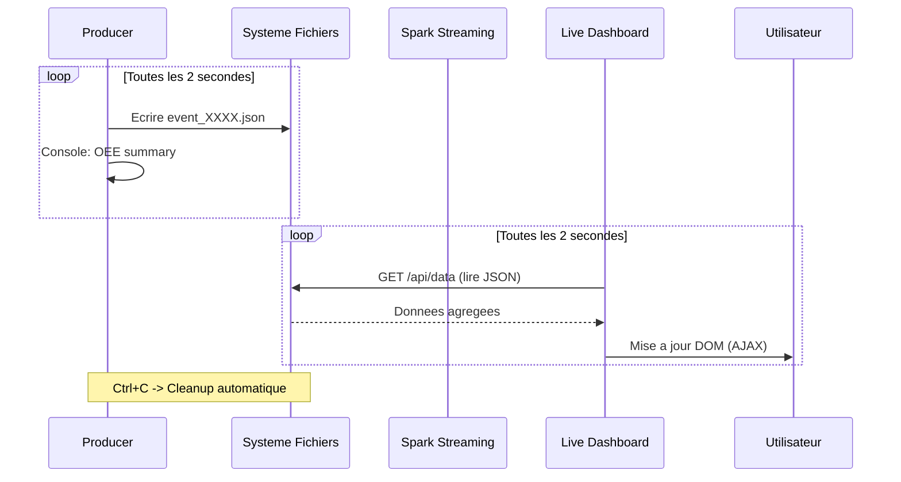

# Rapport Technique Detaille - OEE Analytics Pipeline

## Projet : Pipeline d'Analyse OEE (Overall Equipment Effectiveness)

**Auteur** : Genere automatiquement  
**Date** : 20 Avril 2026  
**Stack** : Python 3.14 | PySpark 3.5.5 | Hadoop 3.x | Docker | Power BI  
**Statut** : Operationnel - Pipeline execute avec succes

---

## Table des Matieres

1. [Introduction et Contexte](#1-introduction-et-contexte)
2. [Architecture Generale](#2-architecture-generale)
3. [Structure du Projet](#3-structure-du-projet)
4. [Phase 1 : Generation des Donnees](#4-phase-1--generation-des-donnees)
5. [Phase 2 : Pipeline ETL PySpark](#5-phase-2--pipeline-etl-pyspark)
6. [Phase 3 : Infrastructure Docker et Hadoop](#6-phase-3--infrastructure-docker-et-hadoop)
7. [Phase 4 : Streaming Temps Reel](#7-phase-4--streaming-temps-reel)
8. [Phase 5 : Visualisation et Power BI](#8-phase-5--visualisation-et-power-bi)
9. [Resultats et Statistiques](#9-resultats-et-statistiques)
10. [Concepts Big Data Appliques](#10-concepts-big-data-appliques)
11. [Guide d'Execution](#11-guide-dexecution)
12. [Annexes](#12-annexes)

---

## 1. Introduction et Contexte

### 1.1 Problematique

Dans l'industrie manufacturiere, le **TRS (Taux de Rendement Synthetique)** ou **OEE (Overall Equipment Effectiveness)** est l'indicateur cle pour mesurer l'efficacite globale des equipements de production. Il combine trois facteurs :

- **Disponibilite (Availability)** : Pourcentage du temps ou la machine est operationnelle
- **Performance** : Vitesse reelle vs vitesse theorique
- **Qualite** : Proportion de pieces conformes produites

### 1.2 Objectif du Projet

Concevoir et implementer un pipeline Big Data complet, de bout en bout, capable de :

1. **Simuler** des evenements de production realistes (10 000+ evenements)
2. **Traiter** ces donnees via un pipeline ETL distribue (PySpark)
3. **Stocker** les resultats dans un systeme de fichiers distribue (HDFS)
4. **Streamer** des evenements en temps reel avec dashboard live
5. **Visualiser** les KPIs OEE dans Power BI Desktop

### 1.3 Formule OEE

```
OEE = Disponibilite x Performance x Qualite

Ou :
  Disponibilite = Temps de fonctionnement reel / Temps planifie
  Performance   = (Temps de cycle ideal x Nombre total pieces) / (Temps reel x 60)
  Qualite       = Pieces conformes / Pieces totales
```

| Niveau OEE | Interpretation |
|------------|----------------|
| >= 85% | World-class |
| 65-85% | Acceptable |
| 45-65% | A ameliorer |
| < 45% | Critique |

---

## 2. Architecture Generale



### 2.1 Flux de Donnees

| Etape | Entree | Traitement | Sortie |
|-------|--------|------------|--------|
| 1. Generation | Parametres de simulation | Numpy + Random | CSV (486 KB) |
| 2. Ingestion | CSV brut | Spark DataFrame | DataFrame type |
| 3. Nettoyage | DataFrame brut | Filtrage, cast, validation | DataFrame nettoye |
| 4. Calcul OEE | DataFrame nettoye | Formules OEE + clamping | DataFrame OEE |
| 5. Aggregation | DataFrame OEE | GroupBy machine + month | Summary mensuel |
| 6. Export | DataFrames finaux | Pandas fallback (Windows) | Parquet + CSV |

---

## 3. Structure du Projet

```
projet/
|-- data/
|   |-- generate_data.py          # Generateur de donnees synthetiques
|   |-- raw/
|   |   |-- production_events.csv  # 10 000 evenements bruts
|   |   |-- production_events.json
|   |-- processed/
|   |   |-- oee_results.csv        # Resultats OEE (Power BI)
|   |   |-- oee_results.parquet    # Format colonnaire optimise
|   |   |-- oee_monthly_summary.csv
|   |   |-- oee_monthly_summary.parquet
|   |   |-- oee_dashboard.html     # Dashboard statique
|   |-- streaming/
|       |-- input/                 # Evenements temps reel (JSON)
|       |-- output/                # Resultats streaming
|       |-- checkpoint/            # Checkpoints Spark Streaming
|
|-- spark/
|   |-- __init__.py
|   |-- oee_pipeline.py            # Pipeline ETL PySpark (5 stages)
|
|-- streaming/
|   |-- producer.py                # Producteur temps reel
|   |-- spark_streaming.py         # Consommateur Spark Streaming
|   |-- live_dashboard.py          # Serveur HTTP dashboard live
|
|-- powerbi/
|   |-- create_dashboard.py        # Integration Power BI + HTML
|
|-- docker-compose.yml             # Orchestration Hadoop/Spark
|-- hadoop.env                     # Configuration HDFS
|-- Makefile                       # Automatisation (make all)
|-- requirements.txt               # Dependances Python
|-- README.md                      # Documentation principale
|-- README_powerbi.md              # Guide Power BI
|-- .gitignore
```

### 3.1 Inventaire des Fichiers

| Fichier | Lignes | Taille | Role |
|---------|--------|--------|------|
| `data/generate_data.py` | 227 | 7.5 KB | Simulation de donnees |
| `spark/oee_pipeline.py` | 518 | 16.4 KB | Pipeline ETL complet |
| `streaming/producer.py` | 335 | 11.0 KB | Producteur temps reel |
| `streaming/spark_streaming.py` | 285 | 9.2 KB | Consommateur streaming |
| `streaming/live_dashboard.py` | 255 | 8.5 KB | Dashboard live AJAX |
| `powerbi/create_dashboard.py` | 290 | 11.2 KB | Integration Power BI |
| `docker-compose.yml` | 97 | 3.1 KB | Orchestration Docker |
| `Makefile` | 100 | 4.2 KB | Automatisation |
| `README.md` | ~400 | 15.2 KB | Documentation |

---

## 4. Phase 1 : Generation des Donnees

### 4.1 Fichier : `data/generate_data.py`

#### Parametres de Simulation

| Parametre | Valeur | Description |
|-----------|--------|-------------|
| `MACHINES` | M001-M005 | 5 machines industrielles |
| `SHIFTS` | morning, afternoon, night, weekend | 4 postes de travail |
| `NUM_DAYS` | 30 | Fenetre temporelle (Janvier 2025) |
| `TARGET_EVENTS` | 10 000 | Nombre d'evenements generes |
| `SEED` | 42 | Graine aleatoire (reproductibilite) |

#### Profils des Machines

Chaque machine a un profil d'efficacite unique pour simuler la realite industrielle :

| Machine | Nom | Efficacite | Cycle Ideal (s) | Role |
|---------|-----|-----------|------------------|------|
| M001 | CNC Lathe | 92% | 12.0 | Tour CNC |
| M002 | Milling Center | 85% | 18.0 | Centre de fraisage |
| M003 | Press Machine | 88% | 8.0 | Presse industrielle |
| M004 | Assembly Robot | 78% | 25.0 | Robot d'assemblage |
| M005 | Packaging Line | 95% | 15.0 | Ligne d'emballage |

#### Multiplicateurs de Poste

| Poste | Multiplicateur | Logique |
|-------|---------------|---------|
| Morning | 1.00 | Poste de reference |
| Afternoon | 0.95 | Legere fatigue |
| Night | 0.88 | Reduction nocturne |
| Weekend | 0.80 | Effectif reduit |

#### Algorithme de Generation

```python
# Pour chaque evenement :
1. Selectionner aleatoirement (machine, shift, date)
2. Calculer planned_time_min = U(360, 480) * shift_multiplier
3. avail_factor = N(machine_efficiency * shift_mult, 0.08)  # Clampe [0.3, 1.0]
4. actual_runtime = planned_time * avail_factor
5. actual_cycle = ideal_cycle * N(1.12, 0.06)  # Degradation performance
6. total_parts = floor(actual_runtime * 60 / actual_cycle) * U(0.85, 1.0)
7. good_parts = total_parts * N(0.96, 0.025)  # Taux qualite
8. Generer 0-5 evenements de panne (mecaniques, electriques, etc.)
```

#### Schema de Sortie (CSV)

| Colonne | Type | Exemple | Description |
|---------|------|---------|-------------|
| `machine_id` | STRING | M003 | Identifiant machine |
| `shift_id` | STRING | morning | Poste de travail |
| `date` | STRING | 2025-01-15 | Date de production |
| `planned_time_min` | DOUBLE | 432.5 | Temps planifie (min) |
| `actual_runtime_min` | DOUBLE | 389.2 | Temps reel (min) |
| `ideal_cycle_time_sec` | DOUBLE | 8.0 | Cycle theorique (s) |
| `actual_cycle_time_sec` | DOUBLE | 9.12 | Cycle reel (s) |
| `total_parts` | INT | 2456 | Total pieces produites |
| `good_parts` | INT | 2389 | Pieces conformes |
| `downtime_events` | JSON | [...] | Details des arrets |

---

## 5. Phase 2 : Pipeline ETL PySpark

### 5.1 Fichier : `spark/oee_pipeline.py`

Le pipeline est structure en **5 etapes sequentielles** :

### Etape 1/5 : Ingestion (Load)

```python
# Strategie de chargement avec fallback :
1. Tenter HDFS : hdfs://namenode:9000/oee/raw/production_events.csv
2. Si echec (UnknownHostException) -> fallback local
3. Charger CSV avec header et schema infere
4. Validation : verifier que le DataFrame n'est pas vide
```

**Schema Spark impose :**

```python
SCHEMA = StructType([
    StructField("machine_id",          StringType()),
    StructField("shift_id",            StringType()),
    StructField("date",                StringType()),
    StructField("planned_time_min",    DoubleType()),
    StructField("actual_runtime_min",  DoubleType()),
    StructField("ideal_cycle_time_sec", DoubleType()),
    StructField("actual_cycle_time_sec", DoubleType()),
    StructField("total_parts",         IntegerType()),
    StructField("good_parts",          IntegerType()),
    StructField("downtime_events",     StringType()),
])
```

### Etape 2/5 : Nettoyage (Clean)

Regles de nettoyage appliquees :

| Regle | Implementation Spark | Impact |
|-------|---------------------|--------|
| Elimination lignes nulles | `atleastnnonnulls(9, ...)` | Qualite donnees |
| Temps planifie > 0 | `F.col("planned_time_min") > 0` | Evite division par zero |
| Pieces > 0 | `F.col("total_parts") > 0` | Coherence metier |
| Runtime >= 0 | `F.col("actual_runtime_min") >= 0` | Validation physique |
| Cycle ideal > 0 | `F.col("ideal_cycle_time_sec") > 0` | Evite division par zero |
| Parsing date | `to_date(col, "yyyy-MM-dd")` | Typage temporel |

### Etape 3/5 : Calcul OEE (Compute)

```python
# Metriques brutes (ratio 0.0 - 1.0)
availability_raw = actual_runtime_min / planned_time_min
performance_raw  = (ideal_cycle_time_sec * total_parts) / (actual_runtime_min * 60)
quality_raw      = good_parts / total_parts

# Clamping [0.0, 1.0] pour eviter les valeurs aberrantes
for metric in [availability_raw, performance_raw, quality_raw]:
    metric = CASE WHEN metric < 0.0 THEN 0.0
                  WHEN metric > 1.0 THEN 1.0
                  ELSE metric

# OEE final (echelle 0-100, 2 decimales)
oee_pct = round(availability_raw * performance_raw * quality_raw * 100, 2)
```

### Etape 4/5 : Export (Write)

Le pipeline utilise une **strategie d'ecriture a double fallback** :

```
1. Spark Writer (Linux/Docker) -> Parquet + CSV natifs
   |
   +--> Si echec (NativeIO Windows)
        |
        2. Pandas Fallback -> df.collect() + pd.DataFrame + to_parquet/to_csv
```

> **Note technique** : Sur Python 3.12+, `df.toPandas()` echoue car PySpark 3.5 depend de `distutils`
> (supprime). Le fallback utilise `df.collect()` + `row.asDict()` pour contourner ce probleme.

### Etape 5/5 : Aggregation Mensuelle

```python
df_monthly = df_oee
    .groupBy("machine_id", "year_month")
    .agg(
        avg("availability_pct"),   # Moyenne disponibilite
        avg("performance_pct"),    # Moyenne performance
        avg("quality_pct"),        # Moyenne qualite
        avg("oee_pct"),            # Moyenne OEE
        count("*"),                # Nombre d'evenements
        min("oee_pct"),            # Pire OEE
        max("oee_pct"),            # Meilleur OEE
    )
```

### 5.2 Plan d'Execution DAG

Le DAG Spark optimise genere le plan physique suivant :

```
FileScan CSV -> Filter (5 conditions) -> Project (raw metrics) 
    -> Project (clamp) -> Project (percentages)
```

Spark fusionne automatiquement les etapes en un seul stage grace au **pipeline de projection pushdown**.

---

## 6. Phase 3 : Infrastructure Docker et Hadoop

### 6.1 Image Docker

| Propriete | Valeur |
|-----------|--------|
| **Image** | `ayoubesswidi/ensabm-tp-bd:latest` |
| **Base** | Linux (amd64) |
| **Java** | OpenJDK 8 |
| **Hadoop** | /usr/local/hadoop |
| **Spark** | /usr/local/spark |
| **Kafka** | /usr/local/kafka |
| **HBase** | /usr/local/hbase |
| **Hive** | /usr/local/hive |

### 6.2 Services Docker Compose

| Service | Container | Description | Ports |
|---------|-----------|-------------|-------|
| `bigdata-node` | oee-bigdata | Noeud complet Hadoop+Spark | 9870, 9000, 8080, 8088, 4040, 7077 |
| `spark-submit` | oee-spark-submit | Execution du pipeline | - (one-shot) |

### 6.3 Architecture HDFS

```
hdfs://namenode:9000/
    |-- oee/
        |-- raw/
        |   |-- production_events.csv   # Donnees brutes (upload)
        |-- processed/
            |-- oee_results/            # Parquet partitionne
            |-- oee_monthly/            # Summary Parquet
```

### 6.4 Sequence de Demarrage

```
1. docker-compose up -d bigdata-node
2. hdfs namenode -format (si premiere fois)
3. start-dfs.sh    -> NameNode + DataNode
4. start-yarn.sh   -> ResourceManager + NodeManager
5. start-master.sh -> Spark Master
6. start-worker.sh -> Spark Worker
7. healthcheck: hdfs dfs -ls / (toutes les 30s)
```

---

## 7. Phase 4 : Streaming Temps Reel

### 7.1 Architecture Streaming



### 7.2 Producer (`streaming/producer.py`)

| Parametre | Defaut | Description |
|-----------|--------|-------------|
| `--mode` | file | Sortie : file ou kafka |
| `--interval` | 2.0 | Secondes entre les batches |
| `--burst` | 1 | Evenements par intervalle |
| `--max-events` | 0 | Limite (0 = illimite) |

**Caracteristiques :**
- Generation aleatoire basee sur les profils machines (identiques au batch)
- Detection automatique du poste (matin/apres-midi/nuit/weekend) selon l'heure reelle
- Calcul OEE inline pour chaque evenement
- **Auto-nettoyage** : supprime tous les fichiers JSON a l'arret (Ctrl+C)
- Chemins absolus : fonctionne depuis n'importe quel repertoire

### 7.3 Live Dashboard (`streaming/live_dashboard.py`)

| Caracteristique | Implementation |
|-----------------|---------------|
| **Serveur** | `http.server.HTTPServer` (Python stdlib, zero dependance) |
| **Port** | 8050 (configurable) |
| **API** | `GET /` = HTML (charge une seule fois) |
| | `GET /api/data` = JSON (poll toutes les 2s) |
| **Mise a jour** | `fetch()` AJAX, pas de rechargement de page |
| **Charts** | Chart.js 4.4 (CDN) |
| **Theme** | Dark glassmorphism, gradient neon |

**Composants du dashboard :**
- 6 cartes KPI (OEE global, evenements, derniere machine, best/worst)
- Bar chart : OEE moyen par machine
- Line chart : Timeline OEE avec ligne cible 65%
- Tableau : Feed des 15 derniers evenements avec badges couleur

### 7.4 Spark Structured Streaming (`streaming/spark_streaming.py`)

| Concept | Implementation |
|---------|---------------|
| **Source** | File stream (JSON directory watch) ou Kafka |
| **Trigger** | processingTime = 5 secondes |
| **Watermark** | 30 secondes (evenements tardifs) |
| **Window** | Tumbling 30s, slide 10s |
| **Output** | Console + Memory table + JSON files |

```python
# Aggregation en fenetre glissante
df.withWatermark("event_time", "30 seconds")
  .groupBy(window("event_time", "30 seconds", "10 seconds"), "machine_id")
  .agg(avg("oee_pct"), count("*"), min("oee_pct"), max("oee_pct"))
```

---

## 8. Phase 5 : Visualisation et Power BI

### 8.1 Power BI Desktop

| Info | Valeur |
|------|--------|
| **Version** | 2.152.1279.0 |
| **Installation** | Microsoft Store (WindowsApps) |
| **Detection** | Automatique via `Get-AppxPackage` |
| **Lancement** | Automatique par `powerbi/create_dashboard.py` |

#### Procedure d'Import

```
1. Home > Get Data > Text/CSV
2. Naviguer vers : data/processed/oee_results.csv
3. Cliquer "Load"
4. Creer les visuels : bar chart, line chart, KPI cards, slicers
```

#### Colonnes Disponibles (Power BI Ready)

| Colonne | Type | Echelle | Utilisation Power BI |
|---------|------|---------|---------------------|
| `machine_id` | Texte | M001-M005 | Slicer, Axe X |
| `shift_id` | Texte | 4 valeurs | Slicer, Legende |
| `date` | Date | 2025-01-01 a 2025-01-30 | Axe temporel |
| `availability_pct` | Reel | 0-100 | KPI, Gauge |
| `performance_pct` | Reel | 0-100 | KPI, Gauge |
| `quality_pct` | Reel | 0-100 | KPI, Gauge |
| `oee_pct` | Reel | 0-100 | KPI principal |

### 8.2 Dashboard HTML Statique

Genere par `powerbi/create_dashboard.py` dans `data/processed/oee_dashboard.html`.
Inclut : 6 KPIs, bar chart par machine, donut par shift, trend line 30 jours, tableau mensuel.

---

## 9. Resultats et Statistiques

### 9.1 Statistiques Descriptives Globales

| Metrique | Disponibilite | Performance | Qualite | OEE |
|----------|--------------|-------------|---------|-----|
| **Moyenne** | 79.25% | 82.65% | 95.90% | 62.82% |
| **Ecart-type** | 11.30 | 5.85 | 2.37 | 10.17 |
| **Minimum** | 39.43% | 64.20% | 86.13% | 26.55% |
| **Q1 (25%)** | 71.48% | 78.40% | 94.29% | 55.73% |
| **Mediane** | 79.43% | 82.51% | 95.96% | 62.66% |
| **Q3 (75%)** | 87.54% | 86.70% | 97.60% | 69.97% |
| **Maximum** | 100.00% | 99.90% | 100.00% | 96.83% |

### 9.2 OEE par Machine

| Machine | Disponibilite | Performance | Qualite | OEE Moyen | Evenements | Classification |
|---------|--------------|-------------|---------|-----------|-----------|----------------|
| **M005** | 85.40% | 82.64% | 95.98% | **67.72%** | 2 028 | Acceptable |
| **M001** | 82.76% | 82.50% | 95.86% | **65.45%** | 1 969 | Acceptable |
| **M003** | 79.72% | 82.76% | 95.93% | **63.32%** | 1 977 | A ameliorer |
| **M002** | 77.75% | 82.71% | 95.89% | **61.69%** | 1 988 | A ameliorer |
| **M004** | 70.75% | 82.61% | 95.82% | **56.01%** | 2 038 | A ameliorer |

> **Analyse** : M005 (Ligne d'emballage) est la machine la plus performante avec 67.72%.
> M004 (Robot d'assemblage) presente le plus faible OEE (56.01%) principalement 
> a cause d'une faible disponibilite (70.75%).

### 9.3 OEE par Poste de Travail

| Poste | OEE Moyen | OEE Min | OEE Max | Evenements |
|-------|-----------|---------|---------|-----------|
| **Morning** | 69.15% | 39.47% | 96.83% | 2 502 |
| **Afternoon** | 65.69% | 35.68% | 93.68% | 2 471 |
| **Night** | 60.91% | 26.55% | 92.13% | 2 518 |
| **Weekend** | 55.59% | 29.82% | 89.31% | 2 509 |

> **Analyse** : Le poste du matin est le plus performant (69.15%), coherent avec
> les facteurs de multiplication simules. Le weekend montre une degradation de 
> 13.56 points par rapport au matin, refletant un effectif reduit.

### 9.4 Distribution OEE

```
  OEE < 45%  :  ~3%  des evenements  [CRITIQUE]
  45-55%     : ~16%  des evenements  [A AMELIORER]
  55-65%     : ~34%  des evenements  [A AMELIORER]
  65-75%     : ~30%  des evenements  [ACCEPTABLE]
  75-85%     : ~14%  des evenements  [ACCEPTABLE]
  >= 85%     :  ~3%  des evenements  [WORLD-CLASS]
```

### 9.5 Fichiers de Sortie

| Fichier | Lignes | Taille | Format |
|---------|--------|--------|--------|
| `oee_results.csv` | 10 000 | 486 KB | Texte CSV |
| `oee_results.parquet` | 10 000 | 124 KB | Colonnaire compresse |
| `oee_monthly_summary.csv` | 5 | 400 B | Texte CSV |
| `oee_monthly_summary.parquet` | 5 | 6 KB | Colonnaire compresse |

> **Ratio de compression Parquet** : 486 KB (CSV) -> 124 KB (Parquet) = **reduction de 74%**

---

## 10. Concepts Big Data Appliques

### 10.1 Traitement Distribue (PySpark)

| Concept | Application dans le Projet |
|---------|--------------------------|
| **Lazy Evaluation** | Les transformations Spark (filter, withColumn) sont evaluees uniquement lors de l'action (show, write) |
| **DAG Optimization** | Spark fusionne les projections en un seul stage physique |
| **Catalyst Optimizer** | Pushdown des filtres vers la lecture CSV |
| **Tungsten Engine** | Gestion memoire off-heap pour les calculs OEE |
| **Partition Shuffling** | `spark.sql.shuffle.partitions=8` optimise pour le volume |

### 10.2 Stockage Distribue (HDFS)

| Concept | Application |
|---------|------------|
| **Replication** | Factor 1 (dev), configurable a 3 en production |
| **Block Size** | 128 MB par defaut |
| **NameNode** | Metadata centralisee (noeud unique) |
| **DataNode** | Stockage effectif des blocs |

### 10.3 Formats de Donnees

| Format | Avantage | Utilisation |
|--------|----------|-------------|
| **CSV** | Lisible, universel | Import Power BI, echange |
| **JSON** | Semi-structure | Evenements streaming |
| **Parquet** | Colonnaire, compresse | Stockage optimise, requetes analytiques |

### 10.4 Streaming (Spark Structured Streaming)

| Concept | Implementation |
|---------|---------------|
| **Micro-batch** | Traitement toutes les 5 secondes |
| **Watermark** | 30 secondes de tolerance pour evenements tardifs |
| **Tumbling Window** | Fenetres de 30s avec slide de 10s |
| **Checkpoint** | Tolerance aux pannes via journalisation |
| **Exactly-once** | Garantie de traitement unique |

### 10.5 Containerisation (Docker)

| Concept | Application |
|---------|------------|
| **Isolation** | Environnement reproductible (Hadoop + Spark) |
| **Volumes** | `./data:/data` et `./spark:/opt/spark-app` |
| **Health Check** | Verification HDFS toutes les 30s |
| **Profiles** | Spark-submit en mode on-demand |
| **Network** | `oee-network` bridge pour communication inter-services |

---

## 11. Guide d'Execution

### 11.1 Pre-requis

| Composant | Version | Statut |
|-----------|---------|--------|
| Python | 3.14.4 | Installe |
| Java JDK | 17.0.18 (Microsoft OpenJDK) | Installe |
| Docker Desktop | - | Requis pour mode HDFS |
| Power BI Desktop | 2.152.1279.0 | Installe (Store) |
| PySpark | 3.5.5 | Installe (pip) |
| pandas | - | Installe |
| numpy | - | Installe |
| pyarrow | 23.0.1 | Installe |

### 11.2 Execution Mode Local (sans Docker)

```powershell
# 1. Generer les donnees
python data/generate_data.py

# 2. Lancer le pipeline ETL
$env:JAVA_HOME = 'C:\Program Files\Microsoft\jdk-17.0.18.8-hotspot'
$env:HADOOP_HOME = 'C:\Users\iMaDes\Desktop\BIG Data\projet\hadoop'
$env:PATH = "$env:JAVA_HOME\bin;$env:HADOOP_HOME\bin;$env:PATH"
python spark/oee_pipeline.py

# 3. Generer le dashboard et ouvrir Power BI
python powerbi/create_dashboard.py
```

### 11.3 Execution Mode Docker (avec HDFS)

```bash
make all    # = generate + upload-data + run-pipeline + dashboard
```

### 11.4 Execution Streaming Temps Reel

```powershell
# Terminal 1 : Dashboard live
python streaming/live_dashboard.py
# -> Ouvrir http://localhost:8050

# Terminal 2 : Producteur
python streaming/producer.py --burst 2 --interval 2
# -> Ctrl+C pour arreter (nettoyage automatique)
```

### 11.5 Targets Makefile

| Target | Action |
|--------|--------|
| `make all` | Pipeline complet (generate + upload + run + dashboard) |
| `make generate` | Generer les donnees synthetiques |
| `make upload-data` | Upload CSV vers HDFS |
| `make run-pipeline` | Executer le pipeline Spark (Docker) |
| `make run-local` | Executer le pipeline localement |
| `make dashboard` | Generer dashboard + lancer Power BI |
| `make docker-up` | Demarrer le cluster Big Data |
| `make docker-down` | Arreter tous les containers |
| `make clean` | Supprimer les donnees generees |

---

## 12. Annexes

### 12.1 Problemes Resolus

| Probleme | Cause | Solution |
|----------|-------|----------|
| `UnicodeEncodeError cp1252` | Emojis/Unicode dans le code source | Remplacement par ASCII |
| `java: command not found` | JDK absent | Installation OpenJDK 17 via winget |
| `NativeIO UnsatisfiedLinkError` | winutils.exe invalide sur Windows | Fallback pandas pour l'ecriture |
| `ModuleNotFoundError: distutils` | Python 3.12+ supprime distutils | `df.collect()` + `row.asDict()` au lieu de `toPandas()` |
| `ValueError: empty range in randint` | downtime_budget/2 arrondi a 0 | Guard `max_dt >= 1` avant randint |
| Chemin relatif producer | CWD different du projet | `Path(__file__).parent.parent` pour chemin absolu |
| Page refresh saccade | `<meta http-equiv="refresh">` | Remplacement par `fetch()` AJAX |

### 12.2 Dependances Python

```
pandas>=2.0
numpy>=1.24
pyspark==3.5.5
pyarrow>=14.0
```

### 12.3 Variables d'Environnement

```powershell
JAVA_HOME    = C:\Program Files\Microsoft\jdk-17.0.18.8-hotspot
HADOOP_HOME  = C:\Users\iMaDes\Desktop\BIG Data\projet\hadoop
SPARK_HOME   = (utilise par PySpark en bundle)
```

---

*Rapport genere le 20 Avril 2026 -- OEE Analytics Pipeline v1.0*
