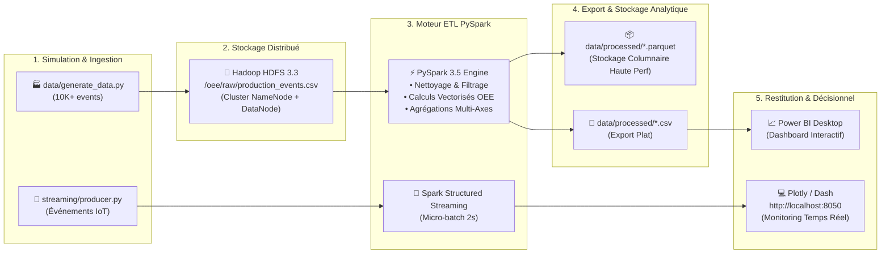

<a id="readme-top"></a>

<!-- PROJECT SHIELDS -->
<div align="center">

[](https://spark.apache.org/)
[](https://hadoop.apache.org/)
[](https://www.python.org/)
[](https://www.docker.com/)
[](https://powerbi.microsoft.com/)
[](https://dash.plotly.com/)
[](https://parquet.apache.org/)

</div>

<br />

<!-- HEADER WITH ANIMATED TYPING SVG -->
<div align="center">
  <h1 align="center">⚙️ OEE Analytics Pipeline</h1>
  
  <a href="https://github.com/imad-elades/OEE-realt-time-calc">
    
  </a>

  <p align="center">
    <strong>Pipeline Big Data distribué pour le calcul, l'analyse et la visualisation en temps réel du Taux de Rendement Synthétique (TRS / OEE).</strong>
    <br />
    Simulation multi-machines, stockage résilient HDFS, traitement par lots (Batch) & flux continu (Structured Streaming), et restitution décisionnelle sur Power BI & Dash.
    <br />
    <br />
    <a href="#-documentation--livrables"><strong>Explorer les Livrables »</strong></a>
    <br />
    <br />
    <a href="docs/Presentation_OEE_Analytics.pptx">📊 Télécharger la Présentation (PPTX)</a>
    ·
    <a href="powerbi/projet.pbix">📈 Télécharger le Tableau de Bord Power BI (.pbix)</a>
    ·
    <a href="RAPPORT.md">📑 Consulter le Rapport Technique (Markdown)</a>
    ·
    <a href="https://github.com/imad-elades/OEE-realt-time-calc/issues">🐛 Signaler un Problème</a>
  </p>
</div>

---

<!-- TABLE OF CONTENTS -->
<details open>
  <summary>📋 <strong>Table des Matières</strong></summary>
  <ol>
    <li><a href="#-à-propos-du-projet">À Propos du Projet</a></li>
    <li><a href="#-documentation--livrables">Documentation & Livrables</a></li>
    <li><a href="#-formule-et-métriques-oee">Formule et Métriques OEE</a></li>
    <li><a href="#-architecture-du-pipeline">Architecture du Pipeline</a></li>
    <li><a href="#-structure-du-projet">Structure du Projet</a></li>
    <li>
      <a href="#-démarrage-rapide">Démarrage Rapide</a>
      <ul>
        <li><a href="#lancement-en-1-clic-windows">Lancement en 1 clic (Windows)</a></li>
        <li><a href="#avec-docker-cluster-complet">Avec Docker (Cluster complet)</a></li>
        <li><a href="#mode-local-autonome">Mode local autonome</a></li>
        <li><a href="#mode-streaming-temps-réel">Mode Streaming Temps Réel</a></li>
      </ul>
    </li>
    <li><a href="#-connexion-power-bi">Connexion Power BI</a></li>
    <li><a href="#-concepts-big-data-clés">Concepts Big Data Clés</a></li>
    <li><a href="#-auteur--contexte">Auteur & Contexte</a></li>
    <li><a href="#-licence">Licence</a></li>
  </ol>
</details>

---

## 💡 À Propos du Projet

Dans l'industrie manufacturière moderne (Industrie 4.0), le **TRS** (*Taux de Rendement Synthétique*) ou **OEE** (*Overall Equipment Effectiveness*) est le KPI de référence international pour évaluer l'efficacité de la production.

Ce projet implémente une solution Big Data complète de bout en bout :
* 🏭 **Génération industrielle réaliste** : Simulation de plus de 10 000 événements de production sur 5 machines industrielles, 4 équipes (shifts), 30 jours, avec pannes, micro-arrêts et variations de cadence.
* 📦 **Stockage distribué tolérant aux pannes** : Ingestion et persistance sur **Hadoop HDFS** aux formats CSV, Parquet et JSON.
* ⚡ **Traitement distribué haute performance** : Pipeline ETL optimisé en **PySpark 3.5** utilisant l'optimiseur Catalyst et l'exécution Vectorisée Tungsten.
* 🌊 **Dual-Engine (Batch + Streaming)** : Traitement par lots pour les bilans périodiques et **Spark Structured Streaming** pour le suivi temps réel des capteurs machine.
* 📊 **Visualisation Décisionnelle** : Tableau de bord exécutif complet dans **Microsoft Power BI** (`.pbix`) et dashboard interactif en continu avec **Plotly Dash**.

<p align="right">(<a href="#readme-top">Retour en haut ⬆️</a>)</p>

---

## 📚 Documentation & Livrables

Tous les livrables d'ingénierie et de soutenance sont directement accessibles :

| Document / Ressource | Format | Description | Lien Direct |
|:---|:---:|:---|:---:|
| **Présentation Officielle** | PPTX | Diapositives de soutenance (14 slides) : problématique industrielle, architecture technique, benchmark et KPIs. | [📊 **Télécharger la Présentation**](docs/Presentation_OEE_Analytics.pptx) |
| **Tableau de Bord Power BI** | PBIX | Modèle de données complet, mesures DAX, cartes KPI, matrice TRS et analyses de tendances. | [📈 **Télécharger projet.pbix**](powerbi/projet.pbix) |
| **Rapport Technique Détaillé** | Markdown | Rapport de conception de 25 000+ caractères : architecture logicielle, pipeline ETL, plans DAG et tests. | [📑 **Lire le Rapport (RAPPORT.md)**](RAPPORT.md) |
| **Guide Power BI** | Markdown | Manuel pas-à-pas pour l'actualisation et l'import des données dans Power BI Desktop. | [📘 **Lire README_powerbi.md**](README_powerbi.md) |

<p align="right">(<a href="#readme-top">Retour en haut ⬆️</a>)</p>

---

## 📐 Formule et Métriques OEE

Le calcul du TRS/OEE repose sur le produit de trois facteurs fondamentaux :

<div align="center">

```
┌────────────────────────────────────────────────────────────────────────┐
│               OEE (TRS) = Disponibilité × Performance × Qualité        │
└────────────────────────────────────────────────────────────────────────┘
```

</div>

### 🔍 Décomposition des Composants

| Pilier | Formule Mathématique | Signification Industrielle | Seuil Cible (World Class) |
|:---|:---|:---|:---:|
| ⏱️ **Disponibilité (A)** | `actual_runtime_min / planned_time_min` | Mesure les arrêts machines non planifiés et pannes. | **≥ 90.0%** |
| ⚡ **Performance (P)** | `(ideal_cycle_time_sec × total_parts) / (actual_runtime_min × 60)` | Mesure les ralentissements et micro-arrêts de cadence. | **≥ 95.0%** |
| 🎯 **Qualité (Q)** | `good_parts / total_parts` | Mesure le taux de conformité (pièces sans rebut ni retouche). | **≥ 99.9%** |
| 🏆 **OEE Global** | `Disponibilité × Performance × Qualité` | Efficacité globale de la ligne de fabrication. | **≥ 85.0%** |

### 📊 Exemple Concret de Calcul

```
Poste : M001  |  Équipe : Matin (Morning)  |  Durée planifiée : 480 min (8h)

Entrées brutes :
  • Temps de fonctionnement effectif = 432 min (48 min d'arrêt cumulé)
  • Cadence idéale théorique         = 12 s/pièce
  • Total pièces produites           = 1 920 pièces
  • Pièces conformes (bonnes)        = 1 843 pièces (77 rebuts)

Calculs intermédiaires :
  ✓ Disponibilité = 432 / 480                  = 0.9000  (90.00%)
  ✓ Performance   = (12 × 1920) / (432 × 60)   = 0.8889  (88.89%)
  ✓ Qualité       = 1843 / 1920                = 0.9599  (95.99%)

Résultat final :
  ★ TRS / OEE = 0.9000 × 0.8889 × 0.9599       = 0.7679  (76.79% - Statut : Bon)
```

<p align="right">(<a href="#readme-top">Retour en haut ⬆️</a>)</p>

---

## 🏛 Architecture du Pipeline



### 🐳 Services Conteneurisés (Docker Compose)

| Conteneur | Image Docker | Ports Exposés | Rôle & Ressources |
|:---|:---|:---:|:---|
| `namenode` | `apache/hadoop:3.3.6` | `9870`, `9000` | Maître HDFS + Interface Web d'administration |
| `datanode` | `apache/hadoop:3.3.6` | — | Nœud de stockage distribué résilient |
| `spark-master` | `bitnami/spark:3.5` | `8080`, `7077` | Ordonnanceur central Spark + Web UI |
| `spark-worker` | `bitnami/spark:3.5` | — | Nœud d'exécution (2 cœurs CPU, 2 Go RAM) |
| `spark-submit` | `bitnami/spark:3.5` | — | Conteneur éphémère de soumission de job |

<p align="right">(<a href="#readme-top">Retour en haut ⬆️</a>)</p>

---

## 📁 Structure du Projet

```
OEE-realt-time-calc/
├── docs/                               # Documentation académique et livrables
│   └── Presentation_OEE_Analytics.pptx # Support de soutenance officiel (14 diapositives)
├── data/
│   └── generate_data.py                # Générateur de 10 000+ événements industriels réalistes
├── spark/
│   ├── __init__.py
│   └── oee_pipeline.py                 # Pipeline ETL PySpark complet (Batch)
├── streaming/
│   ├── producer.py                     # Simulateur de capteurs IoT industriels en streaming
│   ├── spark_streaming.py              # Pipeline Spark Structured Streaming
│   └── live_dashboard.py               # Serveur Web Dash temps réel (port 8050)
├── powerbi/
│   ├── projet.pbix                     # Tableau de bord Power BI prêt à l'emploi
│   ├── create_dashboard.py             # Script de construction automatisée
│   ├── auto_import.py                  # Script d'import et de rafraîchissement
│   └── setup_dashboard.py              # Configuration environnementale
├── hadoop/
│   └── bin/winutils.exe                # Utilitaires d'émulation Hadoop sous Windows
├── docker-compose.yml                  # Déploiement du cluster multinœuds (Hadoop + Spark)
├── hadoop.env                          # Variables d'environnement HDFS
├── Makefile                            # Commandes automatisées de build & test
├── requirements.txt                    # Dépendances Python (pyspark, dash, pandas, plotly)
├── setup_and_run.bat                   # Script d'installation et de test complet (Windows)
├── lancement.bat                       # Lanceur rapide (Dashboard Live + Power BI)
├── RAPPORT.md                          # Rapport technique exhaustif
└── README_powerbi.md                   # Guide de prise en main de Power BI
```

<p align="right">(<a href="#readme-top">Retour en haut ⬆️</a>)</p>

---

## 🚀 Démarrage Rapide

### 💻 Lancement en 1 clic (Windows)

Deux scripts batch automatisés sont prêts à l'emploi :

```cmd
:: 1. Installation complète, vérification des prérequis et lancement du pipeline
setup_and_run.bat

:: 2. Lancement direct du dashboard temps réel et ouverture de Power BI
lancement.bat
```

---

### 🐳 Avec Docker (Cluster complet)

```bash
# 1. Cloner le dépôt
git clone https://github.com/imad-elades/OEE-realt-time-calc.git
cd OEE-realt-time-calc

# 2. Exécuter l'intégralité du pipeline via Makefile
make all

# Les interfaces Web sont disponibles sur :
# • Spark Master UI : http://localhost:8080
# • Hadoop HDFS UI  : http://localhost:9870
```

---

### 🐍 Mode local autonome (sans Docker)

```bash
# 1. Créer et activer l'environnement virtuel
python -m venv venv
venv\Scripts\activate      # Sous Windows
source venv/bin/activate    # Sous Linux/macOS

# 2. Installer les dépendances
pip install -r requirements.txt

# 3. Générer les données de production
python data/generate_data.py

# 4. Exécuter le pipeline PySpark
python spark/oee_pipeline.py
```

---

### 🌊 Mode Streaming Temps Réel

Pour simuler un flux continu d'événements de machines en fonctionnement :

```bash
# Terminal 1 : Démarrer le serveur de monitoring en direct
python streaming/live_dashboard.py
# -> Ouvrir http://localhost:8050 dans votre navigateur

# Terminal 2 : Démarrer le flux continu de données IoT
python streaming/producer.py --burst 2 --interval 2
```

<p align="right">(<a href="#readme-top">Retour en haut ⬆️</a>)</p>

---

## 📊 Connexion Power BI

Le fichier [`powerbi/projet.pbix`](powerbi/projet.pbix) est préconfiguré pour consommer directement les données produites par le pipeline PySpark :

1. Ouvrez [`powerbi/projet.pbix`](powerbi/projet.pbix) avec **Power BI Desktop**.
2. Si vous avez recalculé de nouvelles données, cliquez simplement sur **Accueil ➔ Actualiser**.
3. Pour recharger le fichier manuellement : **Obtenir des données ➔ Texte/CSV ➔ Sélectionner `data/processed/oee_results.csv`**.

<div align="center">
  
</div>

<p align="right">(<a href="#readme-top">Retour en haut ⬆️</a>)</p>

---

## 🧠 Concepts Big Data Clés

### ⚡ RDD vs DataFrame (Catalyst & Tungsten)
Le pipeline s'appuie exclusivement sur les **DataFrames PySpark** plutôt que sur les RDD bas niveau pour bénéficier des optimisations majeures du moteur :
* **Catalyst Optimizer** : Réorganisation des filtres, projection pushdown, et élagage des colonnes avant exécution physique.
* **Moteur Tungsten** : Gestion de mémoire hors-tas (*off-heap*), génération de code bytecode à la volée (*whole-stage code generation*) et élimination du surcoût de sérialisation Python/Java.

### 🔄 DAG (Directed Acyclic Graph) & Lazy Evaluation
Toutes les transformations PySpark (`withColumn`, `groupBy`, `filter`) sont construites sous forme de graphe orienté acyclique (**DAG**) sans exécution immédiate (*évaluation paresseuse*). Le calcul n'est déclenché physiquement qu'à l'appel d'une **action** (`.write.parquet()`, `.count()`), évitant tout goulot d'étranglement inutile.

### 💾 Stockage Columnaire (Parquet)
Les résultats sont persistés au format **Apache Parquet**, assurant :
* Compression drastique du volume disque (algorithmes Snappy / Gzip).
* Lecture optimisée par projection verticale (seules les colonnes nécessaires aux calculs sont lues en mémoire).

<p align="right">(<a href="#readme-top">Retour en haut ⬆️</a>)</p>

---

## 👨‍💻 Auteur & Contexte

Projet conçu et développé par :
* **Imad EL ADES (iM@Des)** — Ingénieur en Transformation Digitale Industrielle ([@imad-elades](https://github.com/imad-elades))
* **Cadre :** Projet Big Data & Décisionnel — Année Universitaire 2025-2026.

---

## 📄 Licence

Ce projet est distribué sous licence open-source MIT. Consultez le fichier de licence pour plus d'informations.

<p align="right">(<a href="#readme-top">Retour en haut ⬆️</a>)</p>
